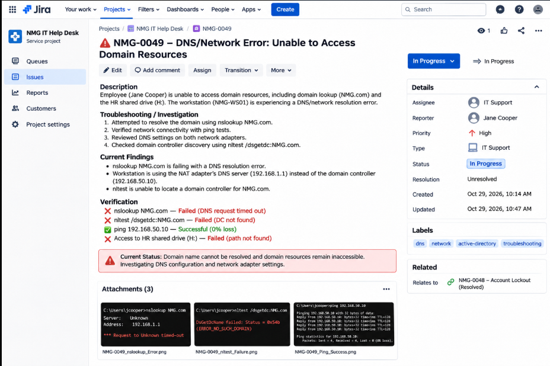
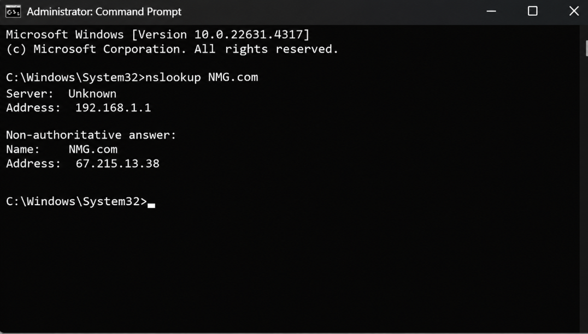
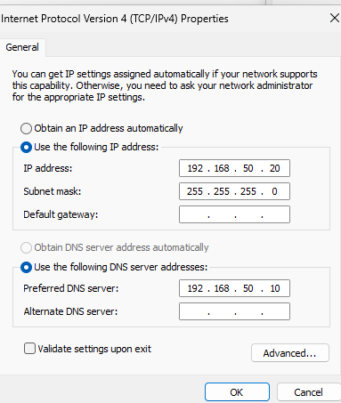
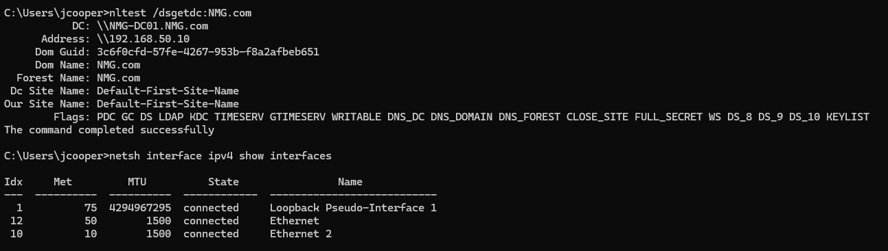
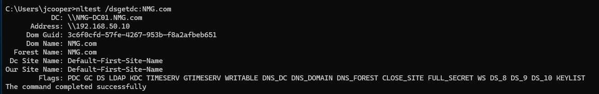
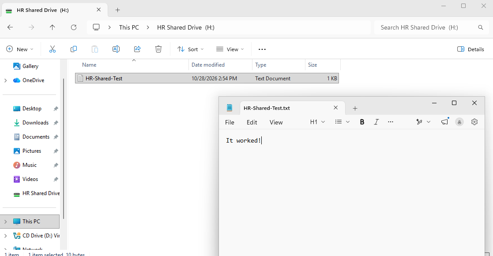
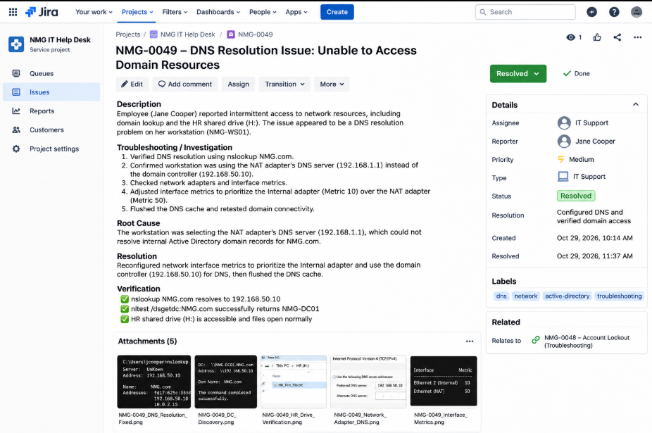

# NMG-0049 — DNS & Network Connectivity Troubleshooting

## Incident Overview

| Field | Details |
|---|---|
| Ticket ID | NMG-0049 |
| Organization | Northstar Medical Group (Simulated) |
| Category | Networking / DNS / Active Directory |
| Priority | Medium |
| Status | Resolved |
| Affected User | Jane Cooper (jcooper) |
| Department | Human Resources |
| Workstation | NMG-WS01 |
| Domain Controller | NMG-DC01 |
| Domain | NMG.com |
| Environment | Windows 11 Pro / Windows Server 2019 |
| Virtualization | Oracle VirtualBox |

## 1. Issue Description

During a simulated IT Help Desk troubleshooting exercise, a DNS configuration issue was identified on NMG-WS01.

The workstation initially queried the NAT adapter's DNS server (`192.168.1.1`) instead of the internal Active Directory DNS server (`192.168.50.10`).

As a result, `NMG.com` resolved to the public IP address `67.215.13.38` rather than the internal domain controller.

This configuration could interfere with Active Directory authentication, domain controller discovery, and access to internal network resources.

**Objective:** Identify the DNS configuration issue, restore internal domain resolution, and verify access to domain resources.

### Initial Help Desk Ticket

The following Jira-style illustration represents the simulated incident before remediation.



*AI-generated illustration. Some additional errors shown in the ticket were not independently verified.*

### Initial DNS Error

The original DNS lookup returned an incorrect public address.

**Recorded findings:**

```text
DNS Server: 192.168.1.1
Domain: NMG.com
Resolved Address: 67.215.13.38
```

The following image reconstructs the original DNS lookup using the values observed during troubleshooting.



*AI-generated reconstruction based on recorded DNS values. Not an original Command Prompt screenshot.*

## 2. Lab Environment

This incident was investigated in my Northstar Medical Group Active Directory homelab using Oracle VirtualBox.

**Technologies Used:**

- Windows Server 2019
- Windows 11 Pro
- Active Directory Domain Services (AD DS)
- Windows DNS
- TCP/IP Networking
- Oracle VirtualBox
- Command Prompt
- Windows Network Connections

**Network Configuration:**

| Component | Configuration |
|---|---|
| Domain Controller | NMG-DC01 |
| Domain Controller Internal IP | 192.168.50.10 |
| Workstation | NMG-WS01 |
| Workstation Internal IP | 192.168.50.20 |
| Active Directory Domain | NMG.com |
| Internal DNS Server | 192.168.50.10 |

The workstation uses two network adapters:

| Adapter | Purpose |
|---|---|
| Ethernet 2 (Internal) | Active Directory lab network |
| Ethernet (NAT) | External network connectivity |

## 3. Troubleshooting Process

### Step 1 — Verify Network Connectivity

Opened Command Prompt on NMG-WS01 and tested connectivity to the domain controller.

```cmd
ping 192.168.50.10
```

**Result:** Successful communication with 0% packet loss.

This confirmed that basic IP connectivity between the workstation and domain controller was functioning.

### Step 2 — Investigate DNS Resolution

Executed:

```cmd
nslookup NMG.com
```

**Finding:** The workstation queried DNS server `192.168.1.1` and returned the public IP address `67.215.13.38`.

To isolate the issue, explicitly queried the internal DNS server:

```cmd
nslookup NMG.com 192.168.50.10
```

**Result:** The internal DNS server successfully returned the domain controller's internal IP address.

This confirmed that the internal DNS service was responding and pointed toward incorrect DNS server selection on the workstation.

### Step 3 — Inspect Network Adapter Configuration

Reviewed the workstation's DNS settings using:

```cmd
netsh interface ipv4 show dnsservers
```

**Findings:**

| Adapter | DNS Server |
|---|---|
| Ethernet (NAT) | 192.168.1.1 |
| Ethernet 2 (Internal) | 192.168.50.10 |

The NAT adapter received its DNS configuration through DHCP, while the internal adapter was statically configured to use the domain controller.



*Actual homelab screenshot showing the internal DNS configuration.*

### Step 4 — Adjust Network Interface Metrics

Opened Network Connections:

```cmd
ncpa.cpl
```

Navigated to the advanced IPv4 settings for both network adapters and configured the following interface metrics:

| Adapter | Interface Metric |
|---|---|
| Ethernet 2 (Internal) | 10 |
| Ethernet (NAT) | 50 |

The internal adapter was assigned the lower interface metric.

After applying the changes and flushing the DNS cache, the workstation successfully queried the internal DNS server.



*Actual homelab screenshot showing the configured interface metrics.*

### Step 5 — Flush DNS Resolver Cache

Executed:

```cmd
ipconfig /flushdns
```

**Output:**

```text
Windows IP Configuration

Successfully flushed the DNS Resolver Cache.
```

This cleared cached DNS resolver information before retesting domain resolution.

## 4. Root Cause Analysis

**Root Cause:** Incorrect DNS server selection on a dual-network-adapter workstation.

NMG-WS01 had two configured DNS servers:

- NAT adapter: `192.168.1.1`
- Internal adapter: `192.168.50.10`

The workstation initially selected the NAT adapter's DNS server, which returned a public IP address for `NMG.com`.

Active Directory clients depend on internal DNS records to locate domain controllers and other domain services.

After adjusting the interface metrics and flushing the DNS cache, the workstation began querying the internal DNS server.

The observed before-and-after results support DNS server selection as the primary cause of the incident.

## 5. Resolution

The following corrective actions were completed:

1. Identified the incorrect DNS server selected by the workstation.
2. Verified that the internal DNS server responded correctly.
3. Inspected DNS settings on both network adapters.
4. Assigned interface metric `10` to Ethernet 2 (Internal).
5. Assigned interface metric `50` to Ethernet (NAT).
6. Flushed the DNS resolver cache.
7. Verified internal domain name resolution.
8. Confirmed domain controller discovery.
9. Tested access to the HR shared drive.

No changes to Active Directory user accounts or file share permissions were required.

## 6. Post-Resolution Verification

### Test 1 — DNS Resolution

Executed:

```cmd
nslookup NMG.com
```

**Verified Output:**

```text
Server:  UnKnown
Address:  192.168.50.10

Name:    NMG.com
Addresses:  fd17:625c:f037:2:91ab:3401:42c3:b8c6
          192.168.50.10
          10.0.2.15
```

**Result:** Passed.

The workstation successfully queried the internal DNS server and received the domain controller's internal IP address.

The `Server: UnKnown` message did not prevent DNS resolution and may indicate a missing reverse DNS record.

### Test 2 — Domain Controller Discovery

Executed:

```cmd
nltest /dsgetdc:NMG.com
```

**Verified Output:**

```text
DC: \\NMG-DC01.NMG.com
Address: \\192.168.50.10
Dom Name: NMG.com
Forest Name: NMG.com

The command completed successfully
```

**Result:** Passed.

The workstation successfully discovered NMG-DC01.



*Actual homelab screenshot confirming successful domain controller discovery.*

### Test 3 — HR Shared Drive Access

Signed in as `NMG\jcooper` and opened the mapped HR departmental drive (`H:`).

Verified that the existing test file was accessible.

**Result:** Passed.



*Actual homelab screenshot confirming successful access to the HR shared drive.*

## 7. Final Help Desk Ticket

The following Jira-style illustration summarizes the incident investigation, corrective actions, and verification results.



*AI-generated Jira-style incident illustration. Not a record from a live Jira system.*

## 8. Resolution Summary

| Verification Test | Result |
|---|---|
| Network connectivity to domain controller | Passed |
| Internal DNS server response | Passed |
| Correct DNS server selection | Passed |
| Internal domain name resolution | Passed |
| Domain controller discovery | Passed |
| HR shared drive access | Passed |

**Final Incident Status: RESOLVED**

## 9. Remaining Configuration Improvement

During DNS verification, the domain controller also returned the address `10.0.2.15`.

This address is associated with the domain controller's NAT adapter.

Although the incident was successfully resolved, registering unwanted NAT addresses in internal Active Directory DNS can cause future connectivity problems.

**Recommended Future Improvement:**

Review DNS registration settings on NMG-DC01 and prevent unnecessary NAT adapter addresses from being published in internal DNS.

This improvement is separate from the resolved incident.

## 10. Skills Demonstrated

- Windows 11 network troubleshooting
- Active Directory DNS troubleshooting
- TCP/IP connectivity testing
- DNS server configuration analysis
- Windows network interface metrics
- DNS cache management
- Domain controller discovery using NLTEST
- Network share connectivity verification
- Root cause analysis
- Incident documentation
- Resolution verification

## 11. Lessons Learned

This exercise demonstrated how incorrect DNS server selection can affect Windows domain environments even when basic network connectivity is functioning.

**Key Takeaways:**

1. Successful ping tests do not guarantee correct DNS configuration.
2. Active Directory clients should use DNS servers capable of resolving internal domain records.
3. Multiple network adapters can complicate DNS server selection.
4. Querying a specific DNS server helps isolate configuration issues.
5. DNS troubleshooting should include functional verification of affected resources.
6. Reconstructed illustrations should be clearly distinguished from actual technical evidence.

## 12. Related Projects

This incident was investigated using the Active Directory environment configured in my existing infrastructure project.

[Windows Infrastructure & Access Control — AD, GPO & RBAC](https://github.com/amendoza454/Windows-Infrastructure---Access-Control--AD-GPO-RBAC)

---

**Ticket:** NMG-0049  
**Status:** Resolved  
**Environment:** Northstar Medical Group (Simulated)  
**Category:** IT Help Desk / DNS / Active Directory / Networking

*All employees, incidents, and organizational details are simulated for educational purposes. AI-generated illustrations are labeled separately from actual homelab screenshots.*
