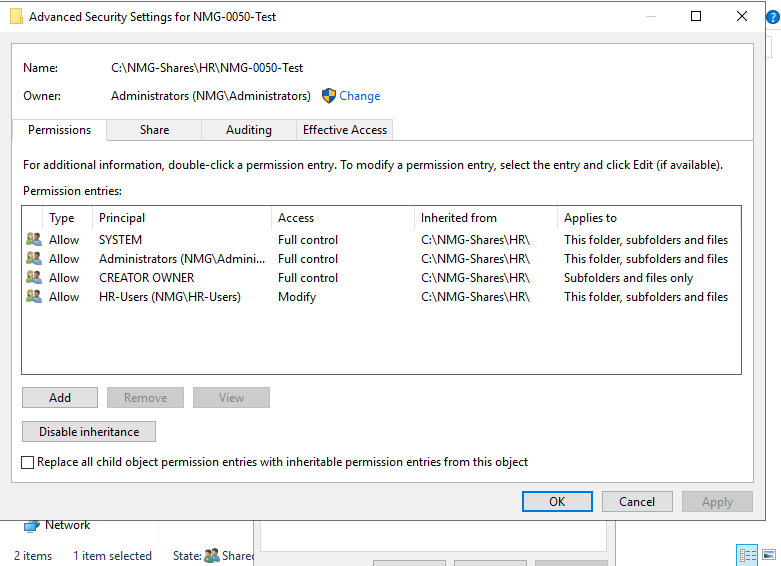
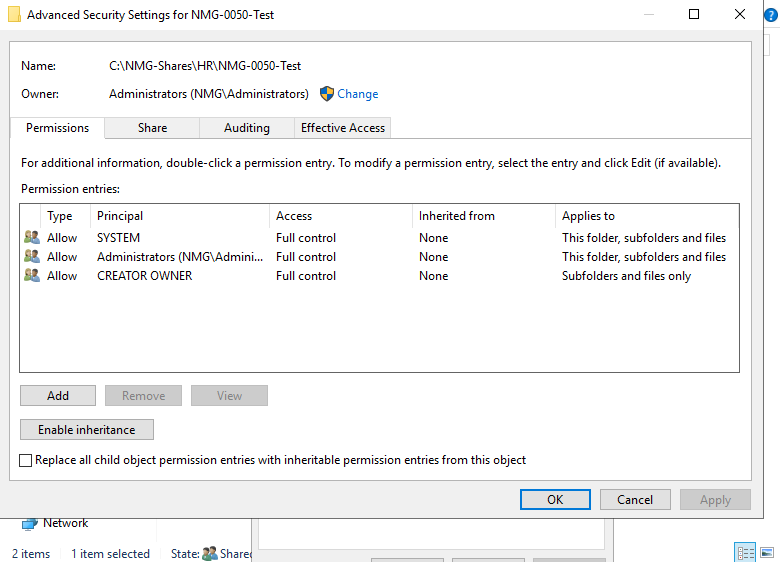
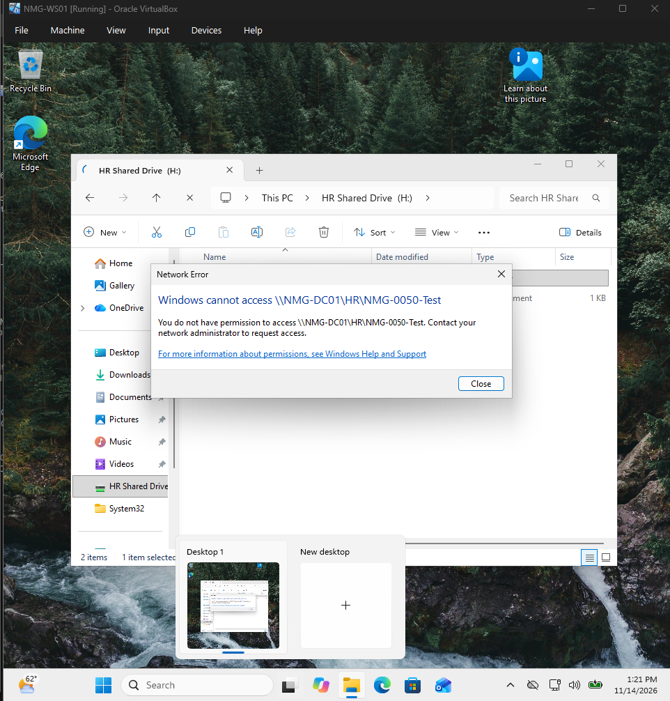
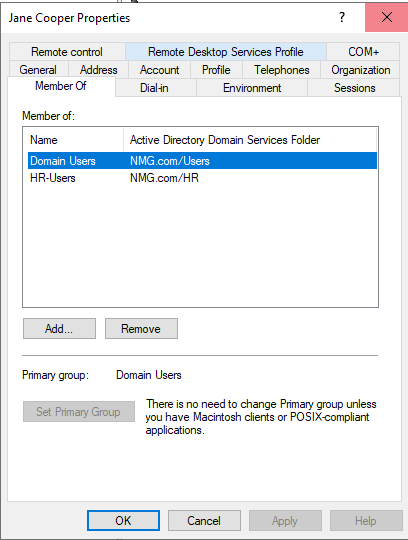
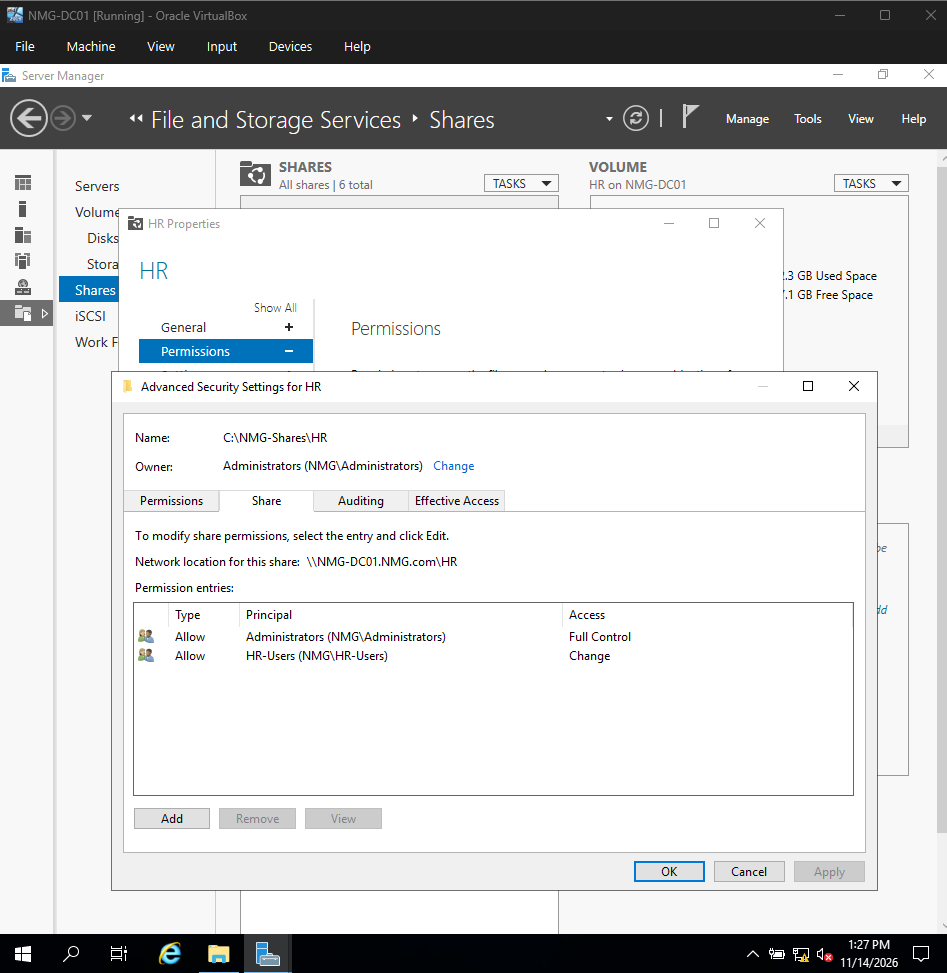
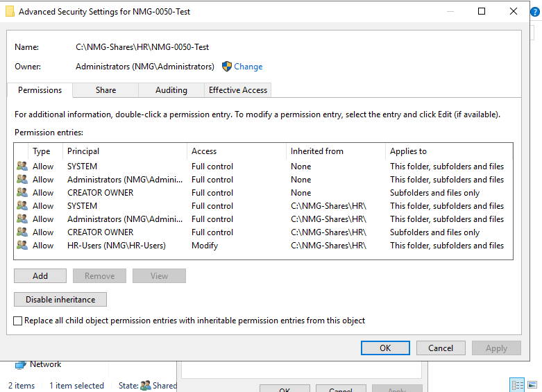
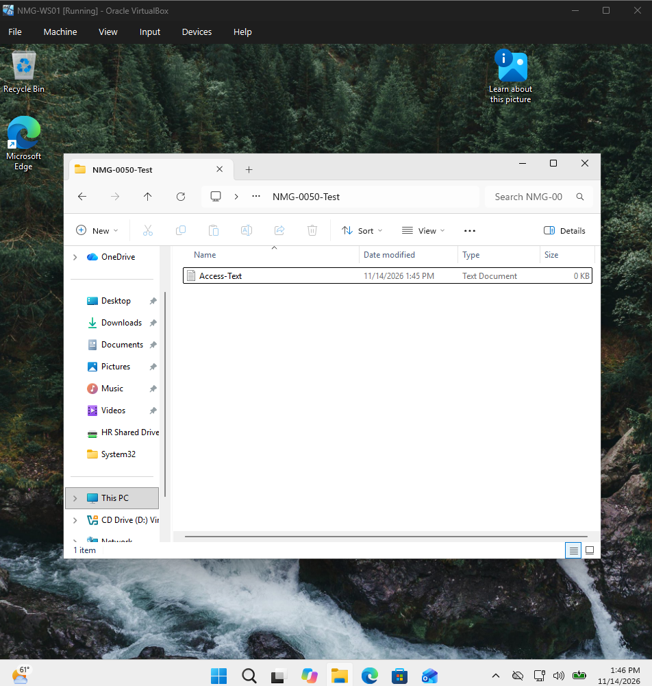

# NMG-0050 — Shared Drive Access Denied

## Incident Overview

| Field | Details |
|---|---|
| Ticket ID | NMG-0050 |
| Organization | Northstar Medical Group (NMG) |
| Incident Type | Shared Folder Access / NTFS Permissions |
| Affected User | Jane Cooper — HR |
| Username | NMG\jcooper |
| Workstation | NMG-WS01 (Windows 11) |
| Server | NMG-DC01 (Windows Server 2019) |
| Domain | NMG.com |
| Affected Resource | HR Shared Drive (H:) |
| Status | Resolved |
| Environment | VirtualBox Active Directory Homelab |

## Incident Description

**Simulated User Report:**

Jane Cooper, an employee in the Human Resources department, reports that she can access the HR shared drive but receives an "Access Denied" error when attempting to open a specific folder.

The affected folder is located at:

`\\NMG-DC01\HR\NMG-0050-Test`

The incident was simulated in an isolated Active Directory homelab by intentionally modifying NTFS permissions on a test folder.

**Objective:** Identify the cause of the access failure, restore the appropriate permissions, and verify that the affected user can access the folder.

## Lab Environment

- **Domain Controller:** NMG-DC01 — Windows Server 2019
- **Client Workstation:** NMG-WS01 — Windows 11
- **Active Directory Domain:** NMG.com
- **Security Group:** HR-Users
- **Network Share:** HR
- **Mapped Drive:** H:
- **Server Folder:** `C:\NMG-Shares\HR`
- **Affected Test Folder:** `C:\NMG-Shares\HR\NMG-0050-Test`

## Troubleshooting and Resolution

### Step 1 — Verify Initial NTFS Permissions

On NMG-DC01, I created a test folder inside the existing HR shared directory.

I opened the folder's Advanced Security Settings and confirmed that permissions were inherited from the parent HR folder.

The original configuration included:

| Security Principal | NTFS Permission |
|---|---|
| SYSTEM | Full Control |
| Administrators | Full Control |
| CREATOR OWNER | Full Control (subfolders and files only) |
| HR-Users | Modify |

This confirmed that the HR security group initially had access to the test folder.

**Evidence — Initial NTFS Permissions**

### Step 2 — Simulate an NTFS Permissions Error

To reproduce a realistic access issue, I disabled inheritance on the test folder.

I converted the inherited permissions into explicit permissions and removed the `HR-Users` permission entry.

I preserved administrative and SYSTEM access and did not modify permissions on the parent HR folder.

This created a controlled permissions issue affecting the test folder.

**Evidence — Incorrect NTFS Permissions**

### Step 3 — Reproduce the Access Denied Error

On NMG-WS01, I accessed the HR mapped drive while signed in as `NMG\jcooper`.

The main HR share remained accessible.

However, opening `NMG-0050-Test` produced the following Windows error:

> Windows cannot access \\NMG-DC01\HR\NMG-0050-Test

Windows also indicated that the user did not have permission to access the folder.

This confirmed that the issue could be reproduced from the affected workstation.

**Evidence — Access Denied**

### Step 4 — Verify Active Directory Group Membership

I opened Active Directory Users and Computers on NMG-DC01 and examined Jane Cooper's account.

Under the **Member Of** tab, I confirmed that Jane belonged to:

- Domain Users
- HR-Users

This ruled out missing HR-Users group membership as the cause of the access failure.

**Evidence — Active Directory Group Membership**

### Step 5 — Verify SMB Share Permissions

Next, I opened Server Manager and navigated to:

**File and Storage Services → Shares → HR → Properties → Permissions**

I examined the SMB share permissions and confirmed:

| Security Principal | Share Permission |
|---|---|
| Administrators | Full Control |
| HR-Users | Change |

The share-level permissions allowed HR-Users to access and modify shared resources.

Because Jane belonged to HR-Users and could access the main HR share, the evidence pointed toward a folder-specific NTFS permissions issue rather than a share-level access problem.

**Evidence — SMB Share Permissions**

### Step 6 — Identify the Root Cause

The investigation established that:

1. Jane Cooper belonged to the correct Active Directory security group.
2. The HR network share granted Change access to HR-Users.
3. Jane could access the main HR shared drive.
4. The affected test folder did not grant HR-Users NTFS access.
5. Windows displayed an Access Denied error when Jane attempted to open the folder.

**Root Cause:**

NTFS permission inheritance had been disabled on `NMG-0050-Test`, and the HR-Users permission entry had been removed.

Although the SMB share permissions were correct, the folder's NTFS permissions did not grant Jane access through her HR security group.

When accessing shared folders over the network, both SMB share permissions and NTFS permissions must allow the requested operation.

### Step 7 — Restore NTFS Permissions

On NMG-DC01, I reopened the test folder's Advanced Security Settings and selected **Enable inheritance**.

After applying the changes, the folder inherited the appropriate permissions from:

`C:\NMG-Shares\HR`

I confirmed that HR-Users appeared again with Modify permissions.

The original explicit SYSTEM, Administrators, and CREATOR OWNER entries were retained alongside the inherited entries.

**Evidence — Restored NTFS Permissions**

### Step 8 — Verify Successful Access

I returned to NMG-WS01 and accessed the HR shared drive as Jane Cooper.

I successfully opened `NMG-0050-Test` without receiving an Access Denied error.

I also created a text document named `Access-Test` inside the folder to verify that the user had write access.

**Verification Results:**

- HR shared drive accessible.
- Test folder opened successfully.
- Text document created successfully.
- No Access Denied error occurred during the final test.

**Evidence — Access Restored**

## Resolution Summary

**Issue:** HR employee unable to access a specific shared folder.

**Root Cause:** Missing HR-Users NTFS permissions caused by disabled inheritance and removal of the group's permission entry.

**Resolution:** Re-enabled NTFS inheritance on the affected test folder, restoring the HR-Users Modify permission inherited from the parent HR directory.

**Verification:** Confirmed successful folder access and text file creation from the Windows 11 workstation.

**Final Status:** Resolved

## Skills Demonstrated

- Windows Server 2019 administration
- Windows 11 troubleshooting
- Active Directory Users and Computers
- Security group membership verification
- SMB share permissions
- NTFS permissions and inheritance
- Role-Based Access Control (RBAC)
- Shared drive troubleshooting
- Root cause analysis
- Incident documentation
- Post-resolution verification

## Key Takeaways

This lab demonstrated the importance of distinguishing between Active Directory group membership, SMB share permissions, and NTFS permissions.

A user can belong to the correct security group and have access to a network share but still be denied access to a specific folder because of its NTFS permissions.

I also practiced a structured help desk troubleshooting process:

**Reproduce → Investigate → Isolate → Resolve → Verify → Document**

---

**Lab Type:** Simulated IT Help Desk Incident  
**Environment:** Oracle VirtualBox / Windows Server 2019 / Windows 11  
**Ticket Status:** Resolved
